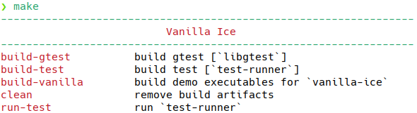
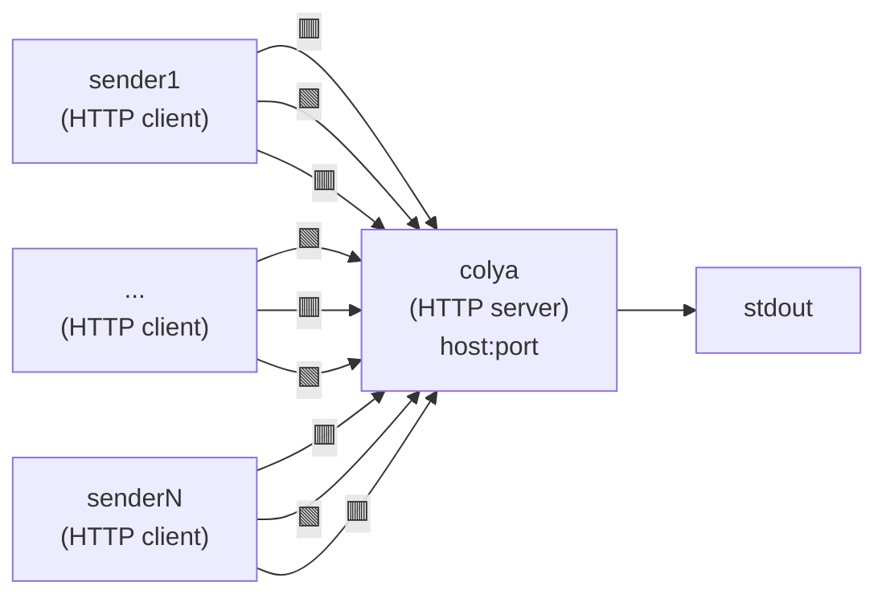

# 1. vanilla-ice 🥶

*What You See Is What You Get (WYSIWIG).*

- [1. vanilla-ice 🥶](#1-vanilla-ice-)
  - [1.1. HOWTO, WTF, RTFM](#11-howto-wtf-rtfm)
    - [1.1.1. Prerequisites](#111-prerequisites)
    - [1.1.2. Build](#112-build)
    - [1.1.3. Third-party](#113-third-party)
  - [1.2. Design](#12-design)
    - [1.2.1. gena (GENerate Alerts)](#121-gena-generate-alerts)
      - [1.2.1.1. ar10 (Apply Rule of 10 sec)](#1211-ar-10-apply-rule-of-10-seconds)
    - [1.2.2. ice (Integrity Check Events)](#122-ice-integrity-check-events)
    - [1.2.3. sender](#123-sender)
    - [1.2.4. colya (COLlector Yet Another)](#124-colya-collector-yet-another)
  - [1.3. Extras](#13-extras)
    - [1.3.1. Won't be done](#131-wont-be-done)

## 1.1. HOWTO, WTF, RTFM

### 1.1.1. Prerequisites

- GCC/Clang with common core C++23 libs;
- CMake 3.14+;
- OpenSSL (runtime lib + headers) installed to satisfy `find_package(OpenSSL REQUIRED)`;

**Optional**: Use Python 3.8+ for input data generation (`tools/gen-baseline.py`, `tools/gen-events.py`). Also do not forget about executable bit (`set +x`).

### 1.1.2. Build

In project directory

```bash
make build
```

will produce `vanilla-ice/build` executable artifacts:

1. `gena`
2. `ice`
3. `sender`
4. `colya`

For getting help, just type `make` or `make help`.



For cleaning up build artifacts, type `make clean`.

**Example:** 1. clean artifacts, 2. build unit tests, 3. run unit tests, 4. build `vanilla-ice/build` executables.

```bash
make clean build-test run-test build-vanilla
```

### 1.1.3 Third-party

1. [OpenSSL](https://www.openssl.org/)
2. [Niels Lohmann's JSON](https://github.com/nlohmann/json)
3. [Yuji Hirose's cpp-httplib](https://yhirose.github.io/cpp-httplib/en/)
4. [Google Test](https://github.com/google/googletest)

## 1.2. Design

### 1.2.1. gena (GENerate Alerts)

Piece of software according to functional requirements:

- get events from file (`events.log`) in [JSON Lines](https://jsonlines.org/) format;
- for `ProcessStarted` events apply [rule](#1211-ar-10-apply-rule-of-10-seconds), if match → `SuspiciousActivityAlert`;

Getting events from file:

- `sensor` thread read `events.log` → push to `queue` // producers;
- `queue` w/o busy-wait (use condition_variable), back pressure (desired);
- `exam` thread apply [rule](#1211-ar-10-apply-rule-of-10-seconds) & send alerts // consumers;
- grace termination (Ctrl+C);

**Note:** it's better to use **absolute paths** in args.

Overview:

```man
[IN]
arg1 - file path (JSON-lines events);

[OUT]
stdout - JSON lines (alerts) etc.

{"alert":"SuspiciousActivityAlert","ppid":1087","pids":[7093,9678,6964,6403,2699,8612]}
...

```

Usage example:

```bash
build/gena tools/events.log | build/sender 127.0.0.3 3333
```

#### 1.2.1.1. AR-10 (Apply Rule of 10 seconds)

If a process (from `ProcessStarted` event type) has **spawned > 5 children** **within 10 seconds** → alert `SuspiciousActivityAlert`.

Alert must contain:

- PID of suspicious (aka "fertile" parent) proccess // PPID;
- list of spawned children PIDs // PIDs

Also source code should demonstrate possible concurrent implementation of **sliding window** based on **timestamps**.

### 1.2.2. ice (Integrity Check Events)

Piece of software according to functional requirements:

- calculate hashsum (SHA-256) for files in given dir;
- compare with reference (from `baseline.json`), if mismatch → event op: `file_added` / `file_modified` / `file_removed`;

**Note:** it's better to use **absolute paths** in args.

Overview:

```man
[IN]
arg1 - dir path;
arg2 - baseline manifest (valid JSON);

[OUT]
stdout - JSON lines (events) etc.

{"op":"file_added","path":"/home/user/ida/loaders/new_file.odt"}
{"op":"file_modified","path":"/home/user/ida/themes/default/theme.css"}
{"op":"file_removed","path":"/home/user/ida/eicar.com"}
...
```

Usage example:

```bash
build/ice ~/ida  ~/baseline-for-ida.json | build/sender 127.0.0.3 3333
```

### 1.2.3. sender

Read `stdin` (JSON-lines format is expected), then send lines to collector `colya` at TCP `host:port`.

Overview:

```man
[IN]
arg1 - host (string);
arg2 - port (number);

[OUT]
stdout - "Sent: ...", "Error: ...", "Not sent: ..." etc. 
```

Usage example:

```bash
build/gena | build/sender 127.0.0.3 3333
build/ice ... | build/sender 127.0.0.3 3333
```

### 1.2.4. colya ("COLlector Yet Another")

From any number of clients (e.g. `gena | sender` or `ice | sender`) at `host:port` gets POST-requests, then reads JSON-lines of alerts/events and print them to `stdout` *as is*.



Overview:

```man
[IN]
arg1 - host (string);
arg2 - port (number);

[OUT]
stdout - JSON-lines

{"op":"file_added","path":"/home/user/ida/loaders/new_file.odt"}
{"op":"file_removed","path":"/home/user/ida/eicar.com"}
{"alert":"SuspiciousActivityAlert","ppid":1087","pids":[7093,9678,6964,6403,8612,2699]}
{"op":"file_modified","path":"/home/user/ida/themes/default/theme.css"}
```

Usage example:

```bash
build/colya 127.0.0.3 3333
```

## 1.3. Extras

### 1.3.1. Won't be done

- Real monitoring via API OS (e.g. `ProcessStarted`, `FileWritten` etc.);
- Cross-compiling (including MSVC), Dockerfile (Containerfile), CI/CD and so on;
- Persistency, TOML/YAML config files, daemon, systemd unit-file;
- Proper exception, error, and corner case handling;
- Proper testing;
- Installer/package;
